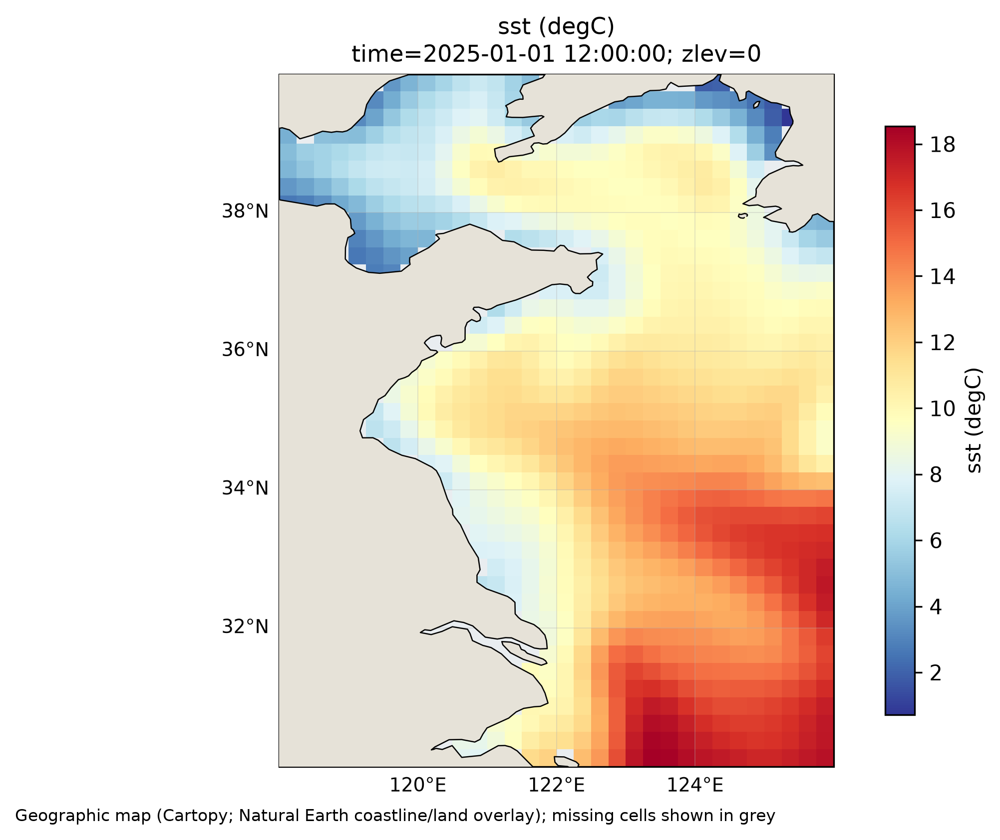
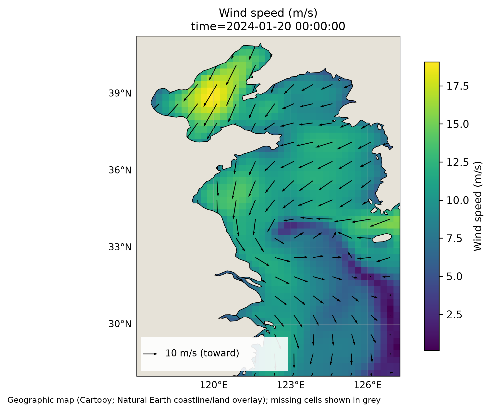

# ocean-plot

[](https://github.com/1460197441-web/ocean-plot/actions/workflows/ci.yml)
[](pyproject.toml)
[](LICENSE)

[English](README.en.md) · [下载 / Releases](https://github.com/1460197441-web/ocean-plot/releases) · [反馈问题](https://github.com/1460197441-web/ocean-plot/issues)

**Ocean NetCDF plotting from the command line: SST maps, wind vectors and point time series, powered by xarray.**

小而明确的海洋 NetCDF 绘图工具：查看文件、海温、风场、单点海温时间序列与离线演示。使用 xarray / NumPy / Matplotlib，不平均额外维度，不填补缺测，不把合成数据当作观测。



仓库：[1460197441-web/ocean-plot](https://github.com/1460197441-web/ocean-plot)。当前版本 0.1.0，尚未发布 PyPI。

## 安装

Python 3.10 或更新版本。建议使用虚拟环境。

```sh
# 稳定版：从 GitHub Release 安装（含 NetCDF4 与地图依赖）
python -m pip install "ocean-plot[netcdf4,maps] @ https://github.com/1460197441-web/ocean-plot/releases/download/v0.1.0/ocean_plot-0.1.0-py3-none-any.whl"
# 或安装 Git 开发版：
python -m pip install "git+https://github.com/1460197441-web/ocean-plot.git"
# 或在下载的仓库根目录：
python -m pip install -e '.[dev,netcdf4]'
ocean-plot --help
```

基础依赖包含 SciPy，支持 NetCDF3；NetCDF4/HDF5 文件另装 `python -m pip install netCDF4`（或本地 `[netcdf4]` extra）。可选 Cartopy：`python -m pip install cartopy`，本地安装也可用 `python -m pip install -e '.[maps]'`。

## 离线演示

```sh
ocean-plot demo --output-dir examples/output
```

生成明确标记为 **SYNTHETIC / not observations** 的海温、风场、时间序列 PNG，海温 PDF，以及合成 NetCDF 和 CSV。无需网络或地图数据；合成缺测区域与时间缺口保持缺测。PNG 以 300 dpi 输出，PDF 中栅格图层同为 300 dpi。示例输出和输入 NetCDF 默认不入 Git。

## 使用自己的数据

先看真实变量、维度、坐标和单位：

```sh
ocean-plot inspect data.nc
ocean-plot sst oisst.nc --time-index 0 --bbox 118 126 30 40 --output sst.png
ocean-plot wind ccmp.nc --time-index 0 --u uwnd --v vwnd --stride 3 --output wind.pdf
ocean-plot timeseries oisst.nc --point 124 35 --output point.png --csv point.csv
```

也可用 `--time 2025-01-01T00:00:00` 精确选择时间，`--depth 0` 按源坐标单位选精确深度，或 `--depth-index 0` 按索引选择。多个时间或深度必须明确选择；单值维度自动压缩，实际值写入日志和图题。日期字符串如果匹配多个记录会报错，不暗自取第一个，也不做月平均。时间序列保留所有时间记录，不支持 `--time`。

自动识别 `longitude/lon`、`latitude/lat`、`time/TIME`，以及 `sst/analysed_sst/sea_surface_temperature/tos`、`uwnd/u10/eastward_wind/u` 和 `vwnd/v10/northward_wind/v`。出现多个候选名会要求显式指定。坐标与变量名可用 `--lon`、`--lat`、`--var`、`--u`、`--v` 覆盖。深度支持 `depth/zlev/lev/level/deptht`；其他维度请预处理成明确切片，不会自动平均或丢弃。

海温接受 Kelvin 和常见摄氏度单位名，Kelvin 减 273.15。未知或缺失单位会报错，请核实来源并修正文件元数据。风分量必须是 **向东、向北** 的地理分量，单位为 m/s（兼容 `m s-1`）；图中箭头指向风吹去的方向，包含 10 m/s 长度图例，底色是 `sqrt(u²+v²)`。提供 `standard_name` 时必须分别为 `eastward_wind` / `northward_wind`；没有该属性时，使用者负责确认方向。软件检查两个分量的维度、坐标、标量时间/深度完全一致；不静默取交集，也不从风向角推算分量。

单位名兼容空格、下划线和大小写，例如 `degrees Celsius`、`kelvins`、`degrees east`、`degrees north`；经纬坐标也接受无方向后缀的 `degrees`，此时依据明确的经纬坐标角色解释。仍拒绝弧度、方向不匹配和未知温度单位。

时间序列按最近格点提取，不插值；请求点必须在裁剪后坐标范围内。CSV 包含真实格点经纬度、时间、变量、单位和原始转换后数值；ISO 时间去掉无意义的小数尾零，保留实际亚秒精度。缺测值写为空单元格，NaN 记录处折线断开。若某个日期完全没有记录，折线仍连接两侧已有记录；工具不猜测采样频率，也不自动补齐日期。图像、CSV 和输入路径必须不同。

## 网格与地图限制

- 仅支持一维经纬度为各自维度坐标的规则地理网格（可非等距）；支持纬度倒序，转为升序并同步重排数据。
- 经度规范到 `[-180, 180)` 并重排；拒绝重复坐标（包括 0/360 双端点）。若内部间隔超过 180°，或内部间隔同时大于循环间隔中位数的三倍及边界循环间隔，会在绘图前报错，避免跨日期变更线区域被拉成长色条。该保守检查可能拒绝高度不均匀的全球网格，请先拆分或重网格；普通全球规则网格仍支持。裁剪使用格点中心、包含边界，不插值边缘。当前不支持跨日期变更线区域，请先将输入文件分成两块处理（仅传 bbox 不会绕过检查）。
- 不支持曲线、交错、投影或旋转网格；检测到非地理 `grid_mapping_name` 会报错。不会旋转网格风。NetCDF 本身不充分标注网格时，使用者必须核对数据说明。
- 默认生成**经纬坐标图，无海岸线**，图下注明这一点。坐标尺度按区域中心纬度近似修正，适用于区域展示；全球与极区建议使用专业投影工具。
- `sst/wind --cartopy` 使用 Plate Carree 和 Natural Earth 50m 海岸线及浅灰米色陆地图层；首次需要网络下载到 Cartopy 缓存。陆地图层只遮盖图像中的陆地底色和箭头，不修改输入数值，不填补沿岸格点。陆地范围来自地图而非产品自带掩码，精细海岸研究请核对产品掩码；海上缺测格点呈灰色。
- 时间序列目前仅支持解码为 NumPy datetime64 的标准日历；360 天等 cftime 日历需先明确处理。只绘制输入记录，不重采样、不做日/月平均。全缺测选择、空裁剪、未知单位和未选择维度均报错。

## 数据来源与示例

工具不捆绑真实数据，也不自动下载数据。可使用 NOAA OISST 和 CCMP 的兼容规则网格文件；请保留原数据的来源、时间、版本、许可与引用要求。数据说明参考 [NOAA OISST](https://www.ncei.noaa.gov/products/optimum-interpolation-sst) 与 [RSS CCMP](https://www.remss.com/measurements/ccmp/)。本仓库的离线 demo 由解析函数合成，不能用于科学结论。

本地验收另使用了已有 OISST 黄海 2025 年切片与 CCMP 2024-01-20 切片。它们是 CLI 兼容性烟测，不代表覆盖所有数据版本。



上图分别由 `sst --time-index 0 --bbox 118 126 30 40 --cartopy` 和 `wind --time-index 0 --cartopy` 生成；源产品 OISST / CCMP，时间为源文件坐标值，未假设其时区。只提交图像，不提交真实数据文件。用于时间序列烟测的 OISST 切片有 364 条时间记录；没有补造缺失日期。

## 开发与验证

```sh
python -m pip install -e '.[dev,netcdf4]'
pytest
python -m build
ocean-plot --help
ocean-plot demo --output-dir examples/output
```

测试覆盖单位转换、缺测、经纬度重排、维度选择、风分量坐标/单位、空裁剪、失败路径、实际格点 CSV、离线图与 PDF。CI 使用 Python 3.10 / 3.12 / 3.13。可选 Cartopy 分支需要安装及海岸线缓存，基础测试不依赖它。

MIT 许可证只覆盖本项目代码，不改变任何外部数据的许可。

如果工具对你有帮助，欢迎 Star、反馈兼容性问题或贡献示例。报告问题时请说明数据产品、变量/坐标名、单位、命令和完整报错；不要上传私有数据或密钥。见 [贡献说明](CONTRIBUTING.md)。
